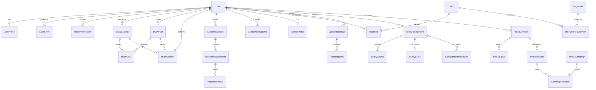

# Sankalp Data Architecture & Database Model

This document outlines the foundation of the PostgreSQL data model for the Sankalp platform. The design embraces a modular domain approach rather than a monolithic "SankalpData" structure. All intelligence and capabilities build upon these shared entities.

## Entity Overview

### Core Identity
- **User**: Core authentication identity. Stores identity level info (id, email, status). Authentication happens here, but complete auth logic is reserved for future implementation.
- **UserProfile**: Demographic and educational profiles tied 1:1 to a user.

### Study Intelligence Domain
- **StudySubject**: A subject/course being tracked by the user.
- **StudyPlan**: A scheduled block of study strategy with a distinct start and end date.
- **StudyGoal**: Target metrics for a specific subject within a StudyPlan.
- **StudySession**: An actual executed event of studying. Logs time spent and completion status.

### Academic Intelligence Domain
- **AcademicCourse**: An enrolled academic course with a target grade.
- **AcademicAssessment**: A specific exam/assignment within an AcademicCourse.
- **AcademicResult**: The achieved grade on an AcademicAssessment.
- **AcademicSnapshot**: Derived data storing calculated metrics/predictions. Persisted temporarily for tracking model predictions over time.

### Career & Skill Intelligence Domain
- **CareerProfile**: Career state tied to a user.
- **Skill**: A globally known skill (can eventually be seeded from open datasets).
- **UserSkill**: The proficiency and evidence a user holds for a Skill.
- **TargetRole**: A job/role definition.
- **RoleSkillRequirement**: The mapping of Skills to TargetRoles with proficiency weights.
- **CareerRoadmap**: A generated roadmap based on weighted skill gaps.
- **RoadmapItem**: Specific actionable steps on a CareerRoadmap.

### Digital Safety Domain
- **SafetyAssessment**: An overarching assessment event.
- **SafetyAnswer**: Normalized answers to assessment questions.
- **SafetyScore**: Calculated aggregate category scores (e.g., password_security).
- **SafetyRecommendation**: Actions recommended based on the assessment.

### Threat Intelligence Domain
- **ThreatAnalysis**: The input event (SMS, URL, extracted text). *Input is always treated as UNTRUSTED*.
- **ThreatSignal**: Immediate extracted signals from the analysis.
- **ThreatIndicator**: A normalized entity (e.g., phone, URL, wallet address). Does not store secrets.
- **ThreatCampaign**: An identified scam campaign (correlation of indicators over time).
- **CampaignIndicator**: Join table mapping ThreatIndicators to ThreatCampaigns with confidence scores.

### Cross-Domain Intelligence
- **Recommendation**: A generic recommendation output from any of the domain intelligence engines. This is derived intelligence, not authoritative truth.

### Audit & Security
- **AuditEvent**: Tracks critical user or system events for auditing and privacy-aware logging. JSONB metadata is used, but never stores passwords, tokens, or PII.

---

## Entity-Relationship Diagram

---

## Database Design Guidelines

### Keys & Indexes
- **Primary Keys**: `UUID` using `uuid_generate_v4()` (or Python `uuid4`) to prevent ID enumeration.
- **Foreign Keys**: Enforce referential integrity for all inter-entity relationships.
- **Indexes**: 
  - All Foreign Keys (`user_id`, `course_id`, etc.) MUST be indexed.
  - Timestamps frequently queried for date ranges (e.g., `created_at`, `started_at`).
  - Threat indicator normalized values (e.g., `value`).

### Data Types & Nullability
- **Timestamps**: All timestamps MUST be timezone-aware (UTC). `created_at` and `updated_at` are automatically managed by SQLAlchemy.
- **Enums**: Used for finite, static state machines (e.g., `completion_status`, `event_type`). For evolving categories, string fields with app-level validation are preferred.
- **JSONB**: Used selectively in `AuditEvent.metadata` or `AcademicSnapshot.model_details`. Must not be used as an excuse to avoid relational modeling.

### Sensitive Data & Privacy
- `User.password_hash` is explicitly named to forbid plaintext storage.
- Audit logs (`AuditEvent`) intentionally avoid capturing raw payload data to ensure compliance and privacy.
- Raw threat submissions (`ThreatAnalysis.content`) are treated as *untrusted* text.

### Retention Considerations
- Derived data (e.g., `SafetyScore`, `Recommendation`, `AcademicSnapshot`) can technically be recalculated. 
- Threat indicator linkages and audit logs may require archiving strategies as volume scales.
